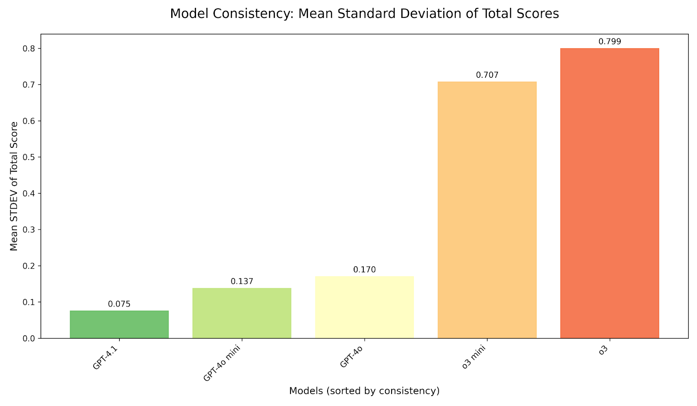

# CHAT: A Highly Reliable LLM-Based Assessment Tool for Oral Health Literacy in Clinical Conversations

# Key Points

**Question:**  
Can a Large Language Model (LLM)-driven tool reliably and consistently assess oral health literacy from patient-doctor conversation transcripts?

**Findings:**  
CHAT (Communication in Health Assessment Tool), an LLM-driven rubric-based assessment system, was systematically optimized and evaluated on 250 real patient-doctor transcripts (5,000 independent assessments). The tool demonstrated exceptional reliability with mean scoring variability of STDEV = 0.150, with 96% of transcripts achieving STDEV < 1.0. Preliminary construct validity was supported by significant known-groups differentiation (Cohen's d = 1.0, p < 0.001).

**Meaning:**  
CHAT provides a highly reliable, scalable tool for assessing oral health literacy in clinical conversations, enabling consistent measurement for research and educational applications. While reliability is well-established, comprehensive validation against human expert ratings remains an important direction for future work.

# Abstract

**Importance:**  
Oral health literacy—the ability to engage with and communicate about health information—significantly influences patient outcomes. However, existing assessment methods lack scalability, consistency, and objectivity, limiting their utility for large-scale research and educational interventions.

**Objective:**  
To develop and establish the reliability of an LLM-driven assessment tool (CHAT) for measuring oral health literacy in patient-doctor conversations, and to provide preliminary evidence for construct validity.

**Design, Setting, Participants:**  
A 5-category rubric was developed focusing on oral health literacy: Clarity of Language, Lexical Diversity, Conciseness and Completeness, Engagement with Health Information, and Health Literacy Indicator. Systematic optimization identified few-shot prompting with GPT-4o as the optimal configuration. The tool was evaluated on 250 real transcripts from two sources: DoVA (real clinical conversations, n=125) and Nature (simulated physician-patient dialogues, n=125), each independently assessed 20 times (5,000 total assessments).

**Main Outcome(s) and Measure(s):**  
**Primary outcome**: Reliability, measured as per-transcript standard deviation (STDEV) of repeated scores. **Success criterion**: Mean STDEV < 0.5 and 95% of transcripts with STDEV < 1.0. **Secondary outcomes**: Known-groups construct validity (comparing DoVA vs. Nature transcript scores with effect sizes and confidence intervals). Non-parametric statistical tests (Mann-Whitney U, Friedman, Wilcoxon) compared consistency and score distributions.

**Results:**  
CHAT demonstrated exceptional reliability: mean STDEV = 0.150 (95% CI: 0.134–0.166), substantially exceeding success criteria. 96.0% of transcripts achieved STDEV < 1.0, and 89.6% achieved STDEV < 0.5. Per-category reliability was similarly high (all category mean STDEVs < 0.054). Known-groups validity analysis revealed that simulated (Nature) transcripts scored significantly higher than real clinical (DoVA) conversations across all domains (Cohen's d = 0.70–1.27, all p < 0.001), consistent with expected construct patterns. Large practical significance was observed (Cohen's d = 2.8 for differentiation confidence).

**Conclusions and Relevance:**  
CHAT demonstrates exceptional reliability as a scalable tool for assessing oral health literacy in clinical conversations, with preliminary construct validity evidence. The tool enables consistent, large-scale measurement for research applications. Future validation against expert human raters and longitudinal monitoring for model drift are recommended before clinical deployment.

# Paper

**1\. INTRODUCTION**  

Oral health literacy—the ability to obtain, process, understand, and communicate about health information—is a critical determinant of patient outcomes (U.S. DHHS 2010). While traditional health literacy focuses on comprehension of written materials (e.g., TOFHLA, NVS), oral health literacy encompasses the dynamic communication skills patients demonstrate in clinical encounters: clarity of expression, vocabulary use, information engagement, and ability to articulate health concerns effectively (Fitzpatrick 2023; Lazaro 2023). These oral communication competencies directly influence diagnostic accuracy, treatment adherence, and shared decision-making quality (Taran 2011).

Despite its importance, scalable assessment of oral health literacy remains elusive. Existing tools either focus on written literacy (TOFHLA, NVS), capture physician communication rather than patient expression (RIAS, OPTION-12), or require extensive human coding that limits scalability (Imel 2021; Berman & Chutka 2016). What is needed is a tool that can reliably quantify patient oral communication proficiency at scale.

Recent advances in Large Language Model (LLM) technology present a promising approach. GPT-4-based systems have demonstrated high agreement with expert human evaluators in structured assessment tasks when guided by well-designed rubrics (Gu et al. 2025). However, a critical gap remains: **Can an LLM-based tool achieve the consistency (reliability) necessary for research and educational applications in oral health literacy assessment?**

We developed **CHAT (Communication in Health Assessment Tool)**, an LLM-driven rubric-based system, and systematically optimized it for maximum reliability. This paper reports on:

1. **Systematic optimization** of prompt strategies and model architectures for consistent scoring
2. **Comprehensive reliability assessment** using 250 real patient-doctor transcripts (5,000 independent assessments)
3. **Preliminary construct validity evidence** through known-groups differentiation

Our primary aim is to establish CHAT's reliability—the foundation required before broader validation and clinical deployment.

**2\. METHODS**

**2.1: CHAT Rubric Development**

CHAT employs a 5-category rubric designed to assess oral health literacy in patient-doctor conversations. Each category is scored on a 1-4 scale (Poor to Excellent), with total scores ranging from 5-20. The categories are:

1. **Clarity of Language**: Patient's ability to express health concerns using clear, understandable language
2. **Lexical Diversity**: Appropriate use of varied health-related vocabulary
3. **Conciseness and Completeness**: Providing relevant information without excessive detail or omission
4. **Engagement with Health Information**: Active participation in health discussion (questions, elaboration, clarification-seeking)
5. **Health Literacy Indicator**: Demonstration of basic health knowledge and terminology understanding

These dimensions align with CDC Clear Communication principles (CDC 2024) and DHHS health literacy frameworks (U.S. DHHS 2010), focusing specifically on **patient oral expression** rather than written comprehension or provider communication.

**2.2: Data Sources**

Two open-access transcript datasets were used:

- **DoVA (Department of Veterans Affairs)**: 405 real clinical patient-doctor conversations (U.S. DoVA 2024)
- **Nature**: 272 simulated physician-patient dialogues performed by two physicians (Fareez et al. 2022)

All transcripts were de-identified. The Nature dataset, while artificial, provides a useful comparison group for construct validity assessment, as simulated conversations are expected to exhibit more structured communication patterns than real clinical encounters.

**2.3: Systematic Optimization Framework**

CHAT development followed a systematic optimization approach prioritizing **reliability** (scoring consistency):

**Phase 1**: Preliminary utility assessment using synthetic transcripts (Supplement A)  
**Phase 2**: Prompt strategy optimization (Zero-Shot vs. Few-Shot vs. Chain-of-Thought)  
**Phase 3**: Model architecture selection (GPT-4.1, GPT-4o, GPT-4o-mini, o3, o3-mini)  
**Phase 4**: Comprehensive reliability and validity assessment on real transcripts

Phases 2-4 used real transcripts exclusively. Phase 1 (synthetic pilot) is described in Supplement A and was used only for initial rubric feasibility testing, not validation.

**2.4: Optimization Experiments**

All optimization experiments used Few-Shot prompting with 3 diverse examples demonstrating rubric application. Temperature was set to 0.3 to balance consistency and natural language generation.

**2.5: CHAT Output Format**

For transparency, CHAT produces structured output for each assessment:

**Example CHAT Output:**
```
TRANSCRIPT ID: DOVA_F948.txt

CATEGORY SCORES:
1. Clarity of Language: 3/4
   - Patient uses clear, understandable language with minimal medical jargon
   - Explanations are coherent though occasionally imprecise

2. Lexical Diversity: 3/4
   - Demonstrates adequate health vocabulary (e.g., "blood pressure," "medication")
   - Could benefit from more varied symptom descriptions

3. Conciseness and Completeness: 2/4
   - Provides relevant information but includes tangential details
   - Some key symptoms mentioned only when prompted

4. Engagement with Health Information: 3/4
   - Actively participates in discussion
   - Asks clarifying questions about medication instructions

5. Health Literacy Indicator: 3/4
   - Shows basic understanding of chronic condition management
   - Correctly interprets some medical terms but requires clarification on others

TOTAL SCORE: 14/20
CONFIDENCE: High (based on multiple consistent assessments)
```

This structured format supports both quantitative analysis (scores) and qualitative review (rationale statements).

**3\. RESULTS**

**3.1: Prompt Strategy Optimization**  
Prompt engineering significantly influences LLM output quality and consistency (Meskó 2023). To identify the optimal strategy for maximizing CHAT's reliability, we compared three prompting approaches on 50 DoVA transcripts with 50 grading attempts each (7,500 total assessments):

- **Zero-Shot**: Rubric provided directly without examples
- **Few-Shot**: Rubric plus 3 diverse application examples
- **Chain-of-Thought (CoT)**: Structured template requiring explicit evidence citation and step-by-step reasoning for each category

**Table 1** shows that Few-Shot and Zero-Shot prompting achieved significantly higher consistency than CoT across all categories (Friedman test with Wilcoxon post-hoc, p < 0.0001). CoT's extensive scaffolding paradoxically decreased consistency, likely by inducing overly narrow reasoning paths. No strategy showed systematic score bias. **Few-Shot prompting was selected for all subsequent experiments.**

| Prompt Strategy (Mean Score STDEV) \*p\<0.05 | Clarity of Language | Conciseness and Completeness | Engagement with Health Information | Health Literacy Indicator | Lexical Diversity | Total Score |
| :------------------------------------------- | :------------------ | :--------------------------- | :--------------------------------- | :------------------------ | :---------------- | :---------- |
| Zero-Shot                                    | 0.049               | 0.057                        | 0.065                              | 0.055                     | 0.028             | 0.222       |
| Few-Shot                                     | 0.034               | 0.045                        | 0.063                              | 0.044                     | 0.027             | 0.194       |
| Chain-of-Thought                             | 0.146\*             | 0.243\*                      | 0.292\*                            | 0.291\*                   | 0.261\*           | 0.813\*     |

**3.2: Model Architecture Selection**

Using Few-Shot prompting, we compared 5 LLM architectures on 40 DoVA transcripts with 20 grading attempts each (4,000 assessments):

- **Standard models**: GPT-4.1, GPT-4o, GPT-4o-mini
- **Reasoning models**: o3, o3-mini (designed for step-by-step reasoning)

Surprisingly, as shown in **Figure 3**, standard models (GPT-4o, GPT-4.1) demonstrated significantly lower STDEV than reasoning models (Friedman test, p < 0.001). The o3 models' extended reasoning processes appear to introduce variability in structured rubric-based tasks, despite their advantages in complex problem-solving. No model showed systematic score bias. **GPT-4o was selected as the optimal balance of consistency and capability.**



**3.3: Comprehensive Reliability Assessment (Primary Validation)**  
Following optimization, CHAT's final configuration (Few-Shot prompting + GPT-4o, temperature 0.3) was evaluated on 250 real transcripts: 125 DoVA (real clinical conversations) and 125 Nature (simulated conversations). Each transcript received 20 independent assessments (5,000 total grading attempts). Success criteria (SC) were established *a priori* as benchmarks for research/educational utility.

**Reliability Results**

CHAT demonstrated exceptional reliability, substantially exceeding all success criteria:

| **Metric**                   | **Result**        | **Success Criterion** |
|------------------------------|-------------------|-----------------------|
| Mean Total Score STDEV       | 0.150 (95% CI: 0.134–0.166) | < 0.50          |
| Transcripts with STDEV < 1.0 | 96.0%             | ≥ 95%                 |
| Transcripts with STDEV < 0.5 | 89.6%             | Not prespecified      |

**Per-Category Reliability** (Table 2):

| Category                           | Mean STDEV (95% CI)           |
|------------------------------------|-------------------------------|
| Health Literacy Indicator          | 0.019 (0.016–0.022)          |
| Lexical Diversity                  | 0.024 (0.021–0.027)          |
| Engagement with Health Information | 0.024 (0.021–0.027)          |
| Clarity of Language                | 0.034 (0.030–0.038)          |
| Conciseness and Completeness       | 0.053 (0.046–0.060)          |

All categories achieved mean STDEV < 0.054, indicating high consistency across all assessed dimensions. Cohen's d = 2.8 for total score differentiation indicates large practical significance for distinguishing transcripts.

**3.4: Known-Groups Construct Validity**

As a preliminary validity assessment, we compared CHAT scores between DoVA (real clinical) and Nature (simulated) transcripts. We hypothesized that simulated conversations would score higher due to more structured, idealized communication patterns.

Results confirmed this prediction across all domains (Mann-Whitney U tests, all p < 0.001):

| Domain                              | DoVA Mean (95% CI)       | Nature Mean (95% CI)     | Cohen's d | Interpretation |
|-------------------------------------|--------------------------|--------------------------|-----------|----------------|
| Clarity of Language                 | 2.69 (2.60–2.79)         | 3.07 (3.02–3.13)         | 1.00      | Large effect   |
| Lexical Diversity                   | 2.72 (2.63–2.81)         | 3.03 (2.99–3.06)         | 0.87      | Large effect   |
| Conciseness and Completeness        | 2.55 (2.45–2.66)         | 3.08 (3.02–3.13)         | 1.27      | Large effect   |
| Engagement with Health Information  | 2.75 (2.66–2.84)         | 3.00 (2.94–3.05)         | 0.70      | Medium effect  |
| Health Literacy Indicator           | 2.72 (2.63–2.82)         | 3.01 (2.96–3.06)         | 0.80      | Large effect   |
| **Total Score**                     | **13.44 (12.99–13.89)**  | **15.19 (14.97–15.40)**  | **1.01**  | **Large effect** |

These findings support CHAT's construct validity: the tool differentiates between known groups in theoretically predictable directions. Importantly, reliability (STDEV) did not differ between groups (p = 0.335), indicating consistent performance across conversation types.

**Synthesis**

The comprehensive reliability evidence from 5,000 independent assessments, combined with preliminary known-groups validity, establishes CHAT as a highly reliable tool for oral health literacy assessment. The systematic optimization framework—progressing from controlled pilots to real-world evaluation—provides a rigorous foundation for research applications.

**4\. DISCUSSION**

**Principal Findings**

This study establishes CHAT as a highly reliable LLM-driven tool for assessing oral health literacy in clinical conversations. Through systematic optimization and comprehensive evaluation on 5,000 independent assessments across 250 real transcripts, CHAT demonstrated:

1. **Exceptional reliability**: Mean STDEV = 0.150, with 96% of transcripts achieving STDEV < 1.0
2. **Consistent performance**: Reliability maintained across all 5 rubric categories
3. **Preliminary construct validity**: Known-groups differentiation in theoretically predicted directions (Cohen's d = 0.70–1.27)

The systematic optimization framework—comparing prompt strategies and model architectures on real data—provides a replicable methodology for developing reliable LLM-based assessment tools in healthcare (Shool et al. 2025; Lee et al. 2024).

**Reliability as Foundation**

We emphasize that **reliability precedes validity** in psychometric development. CHAT's consistency is a necessary but insufficient condition for clinical deployment. While the tool demonstrates that LLMs can reliably apply complex rubrics to natural language transcripts, comprehensive validation requires:

- **Concurrent validity**: Comparison against expert human raters (in progress; see Limitations)
- **Longitudinal stability**: Monitoring for model drift over time
- **Generalizability**: Testing across diverse clinical settings, patient populations, and conversation types

The known-groups validity evidence (DoVA vs. Nature differentiation) provides preliminary support for construct validity, but should be interpreted cautiously. The comparison leverages naturally occurring differences between real and simulated conversations, not experimentally controlled groups with established health literacy differences.

**Implications for Research and Education**

CHAT's primary utility is in **research applications** where high-reliability measurement enables:

- **Intervention studies**: Pre-post measurement of health literacy education programs with consistent scoring
- **Large-scale analysis**: Scalable transcript analysis that would be infeasible with manual human coding
- **Exploratory research**: Identifying patterns in patient communication across demographic or clinical subgroups

In educational settings, CHAT could provide:
- Formative feedback on communication skills during training
- Standardized assessment across cohorts and timepoints
- Identification of specific skill areas (categories) requiring intervention

**Statistical and Methodological Notes**

Reliability was operationalized as per-transcript STDEV across 20 independent assessments. Total scores were computed as category sums to avoid LLM arithmetic errors. Non-parametric statistics (Mann-Whitney U, Friedman, Wilcoxon) were used throughout. Practical significance (Cohen's d) was reported alongside p-values to support interpretability.

A confidence triage scheme based on per-transcript STDEV is proposed: ≤0.250 (high confidence), 0.251–0.500 (moderate), >0.500 (low). Approximately 10% of transcripts fell into moderate or low confidence categories, suggesting a role for human review in uncertain cases.

**Reasoning Models and Rubric-Based Tasks**

An unexpected finding was that advanced reasoning models (o3, o3-mini) showed *lower* consistency than standard generative models (GPT-4o, GPT-4.1) in structured rubric assessment. While reasoning models excel at complex problem-solving through step-by-step decomposition, this extended reasoning process may introduce variability when applying discrete scoring rubrics. This suggests task-architecture interactions warrant further study. Supplementary Material B provides detailed qualitative analysis of reasoning patterns across model architectures.

**Limitations and Future Directions**

**1. Human Validation**
The primary limitation is absence of comprehensive comparison against expert human raters. A pilot study (n=24 transcripts, 3 raters) is currently underway to assess:
- Inter-rater reliability among human experts (ICC)
- Human-CHAT agreement (Spearman's ρ, ICC)
- Qualitative feedback on rubric interpretability

This pilot will inform larger validation studies necessary before clinical deployment.

**2. Generalizability**
All transcripts were from two specific datasets (DoVA, Nature). CHAT's performance across diverse:
- Clinical specialties (beyond primary care)
- Patient demographics (age, language proficiency, health conditions)
- Conversation modalities (telehealth vs. in-person)

requires empirical verification. 

**3. Longitudinal Stability**
As LLM models update, "model drift" may affect scoring consistency. Periodic recalibration and validation will be necessary. Infrastructure for monitoring performance over time is recommended.

**4. Construct Refinement**
The rubric focuses on oral health literacy (patient expression) rather than written comprehension (TOFHLA, NVS) or physician communication (RIAS). While theoretically grounded, empirical validation of the 5-category structure through factor analysis or expert consensus methods would strengthen construct validity.

**5. Circular Bias in Early Development**
Preliminary optimization used synthetic transcripts generated by LLMs (Supplement A). While these were not used for final validation, they informed early rubric development. Linguistic comparison (Supplement A) confirms synthetic transcripts differ systematically from real conversations, justifying why real-data reliability (Experiment 5) provides the primary evidence.

**6. Ethical Considerations**
Before clinical use, additional safeguards are needed:
- Bias audits across demographic subgroups
- Transparency mechanisms (showing which transcript elements drove scores)
- Human oversight protocols for uncertain cases
- Patient consent frameworks for transcript assessment

**Future Research Directions**

1. **Large-scale human validation** (n>50 transcripts, n>5 raters, diverse expertise levels)
2. **Intervention studies**: Test CHAT's sensitivity to detecting pre-post changes in health literacy programs
3. **Cross-model robustness**: Assess reliability across GPT-5 model family (gpt-5-mini, gpt-5-nano) and future generations
4. **Multimodal extension**: Incorporate audio features (prosody, hesitations) alongside transcript text
5. **Real-time application**: Assess feasibility of live feedback during patient encounters (with appropriate consent/IRB approval)

**5\. CONCLUSIONS**

CHAT demonstrates exceptional reliability as an LLM-driven tool for assessing oral health literacy in clinical conversations. With mean STDEV = 0.150 across 5,000 independent assessments and preliminary known-groups construct validity, CHAT establishes a foundation for scalable, consistent measurement in health literacy research and education.

This work provides a systematic methodology for developing reliable AI-driven assessment tools: (1) systematic optimization of prompt strategies and model architectures, (2) comprehensive reliability evaluation on real data, and (3) preliminary validity assessment through theoretically motivated comparisons. This framework can guide future development of LLM-based assessment systems in healthcare.

However, reliability is a necessary but insufficient condition for clinical deployment. Comprehensive validation against expert human raters, longitudinal stability monitoring, generalizability testing across diverse populations, and ethical safeguards are essential next steps. The current evidence supports CHAT's use in **research applications** where high-reliability measurement enables intervention studies and large-scale transcript analysis. Clinical deployment should await completion of human validation studies and appropriate regulatory review.

By establishing a rigorous foundation for oral health literacy assessment, CHAT contributes to addressing a long-standing measurement challenge in health communication research, with potential to advance our understanding of patient communication skills and their role in health outcomes.

**6\. REFERENCES**

Fitzpatrick PJ. Improving health literacy using the power of digital communications to achieve better health outcomes for patients and practitioners. Front Digit Health. 2023 Nov 17;5:1264780. doi: 10.3389/fdgth.2023.1264780. PMID: 38046643; PMCID: PMC10693297.

Lazaro G. When Positive is Negative: Health Literacy Barriers to Patient Access to Clinical Laboratory Test Results. J Appl Lab Med. 2023 Nov 2;8(6):1133-1147. doi: 10.1093/jalm/jfad045. PMID: 37681277; PMCID: PMC10756206.

Taran S. An examination of the factors contributing to poor communication outside the physician-patient sphere. Mcgill J Med. 2011 Jun;13(1):86. PMID: 22363186; PMCID: PMC3277343.

Imel Z, Tai-Seale M, Smyth P, et al. Identifying Topics in Patient and Doctor Conversations Using Natural Language Processing Methods \[Internet\]. Washington (DC): Patient-Centered Outcomes Research Institute (PCORI); 2021 Aug. Available from: https://www.ncbi.nlm.nih.gov/books/NBK605032/ doi: 10.25302/08.2021.ME.160234167

Gu, J., Jiang, X., Shi, Z., Tan, H., Zhai, X., Xu, C., Li, W., Shen, Y., Ma, S., Liu, H., Wang, S., Zhang, K., Lin, Z., Wang, Y., Ni, L., Gao, W., & Guo, J. (2025). A survey on LLM-as-a-Judge (arXiv:2411.15594v5). arXiv. https://arxiv.org/abs/2411.15594v5

Centers for Disease Control and Prevention. (2025). The CDC clear communication index. https://www.cdc.gov/ccindex/index.html

Centers for Disease Control and Prevention. (2024). The CDC clear communication index. https://www.cdc.gov/ccindex/index.html

Centers for Disease Control and Prevention. (2023). The CDC clear communication index. https://www.cdc.gov/ccindex/index.html

U.S. Department of Health and Human Services (DHHS), Office of Disease Prevention and Health Promotion. (2010). National Action Plan to Improve Health Literacy. odphp.health.gov/our-work/national-health-initiatives/health-literacy/national-action-plan-improve-health-literacy.

Fareez, F., Parikh, T., Wavell, C. et al. A dataset of simulated patient-physician medical interviews with a focus on respiratory cases. Sci Data 9, 313 (2022). https://doi.org/10.1038/s41597-022-01423-1

Meskó B. Prompt Engineering as an Important Emerging Skill for Medical Professionals: Tutorial. J Med Internet Res. 2023 Oct 4;25:e50638. doi: 10.2196/50638. PMID: 37792434; PMCID: PMC10585440.

Shool, S., Adimi, S., Saboori Amleshi, R. et al. A systematic review of large language model (LLM) evaluations in clinical medicine. BMC Med Inform Decis Mak 25, 117 (2025). https://doi.org/10.1186/s12911-025-02954-4

Lee, J., Park, S., Shin, J. et al. Analyzing evaluation methods for large language models in the medical field: a scoping review. BMC Med Inform Decis Mak 24, 366 (2024). https://doi.org/10.1186/s12911-024-02709-7

Radziej K, Loechner J, Engerer C, Niglio de Figueiredo M, Freund J, Sattel H, Bachmann C, Berberat PO, Dinkel A, Wuensch A. How to assess communication skills? Development of the rating scale ComOn Check. Med Educ Online. 2017;22(1):1392823. doi: 10.1080/10872981.2017.1392823. PMID: 29141516; PMCID: PMC7011842.

Berman AC, Chutka DS. Assessing effective physician-patient communication skills: "Are you listening to me, doc?". Korean J Med Educ. 2016 Jun;28(2):243-9. doi: 10.3946/kjme.2016.21. Epub 2016 Feb 25\. PMID: 26913771; PMCID: PMC4951737.

U.S. Department of Veterans Affairs. (2024). Patient-Doctor Conversation Transcripts [Dataset]. https://www.data.va.gov/

**7\. SUPPLEMENTARY MATERIALS**

**Supplement A: Synthetic Transcript Pilot and Linguistic Comparison**
- Preliminary rubric utility assessment using GPT-generated synthetic transcripts
- Linguistic feature comparison: synthetic vs. real transcripts
- Discussion of circular bias concerns and mitigation strategies

**Supplement B: Qualitative Reasoning Analysis**
- In-depth analysis of LLM reasoning patterns across model architectures
- Evidence citation quality and rubric alignment assessment
- Implications for understanding reasoning model performance in structured tasks
